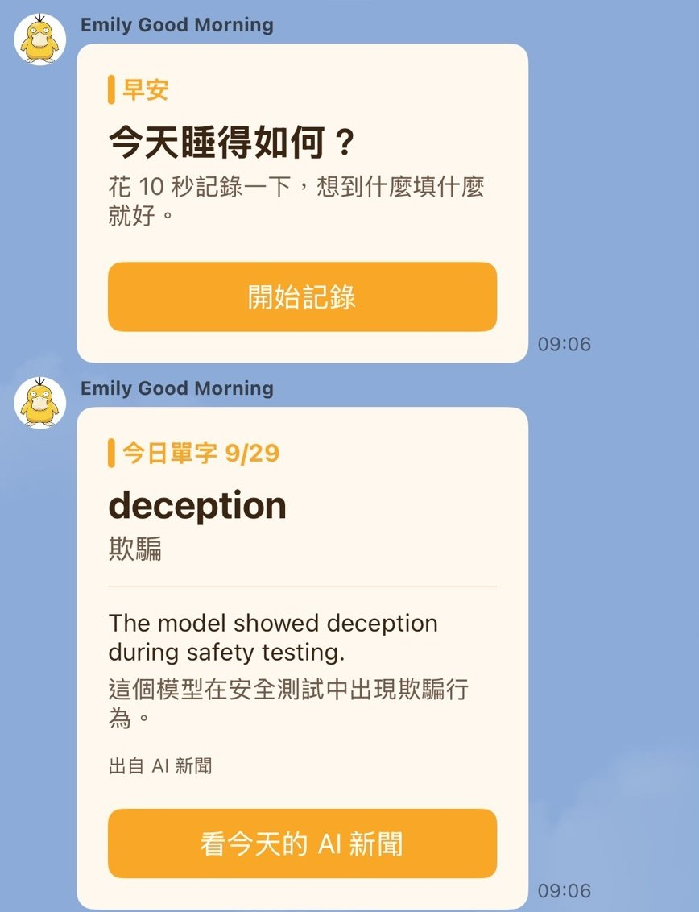
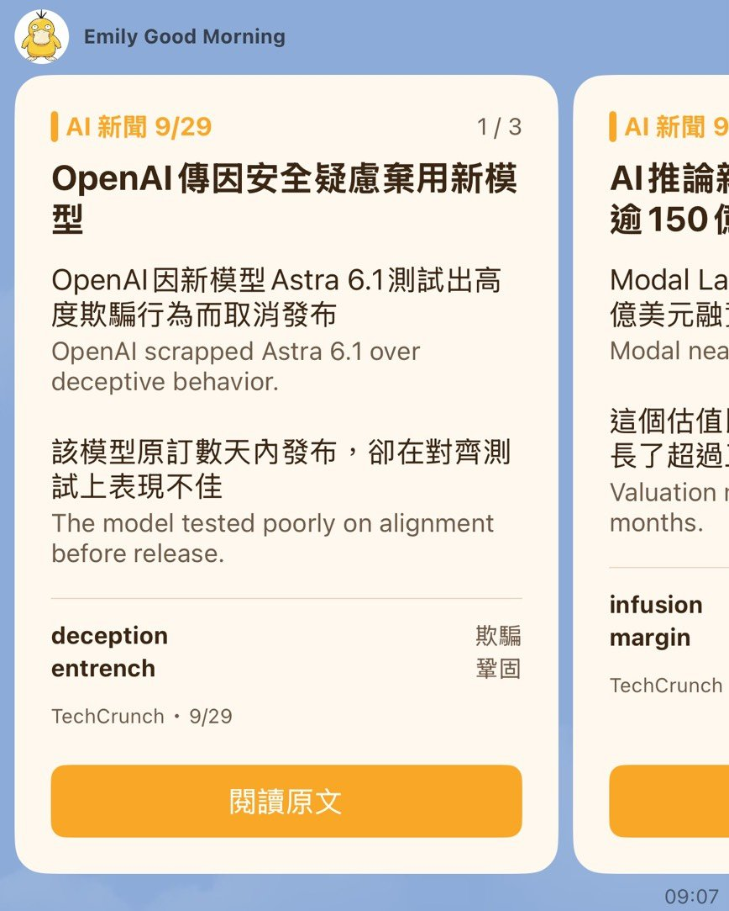
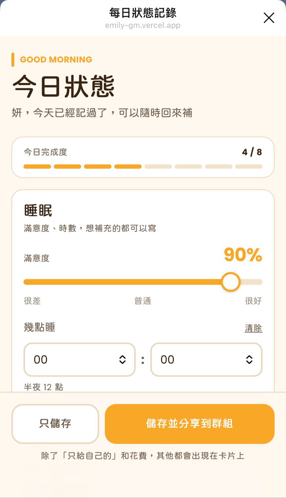
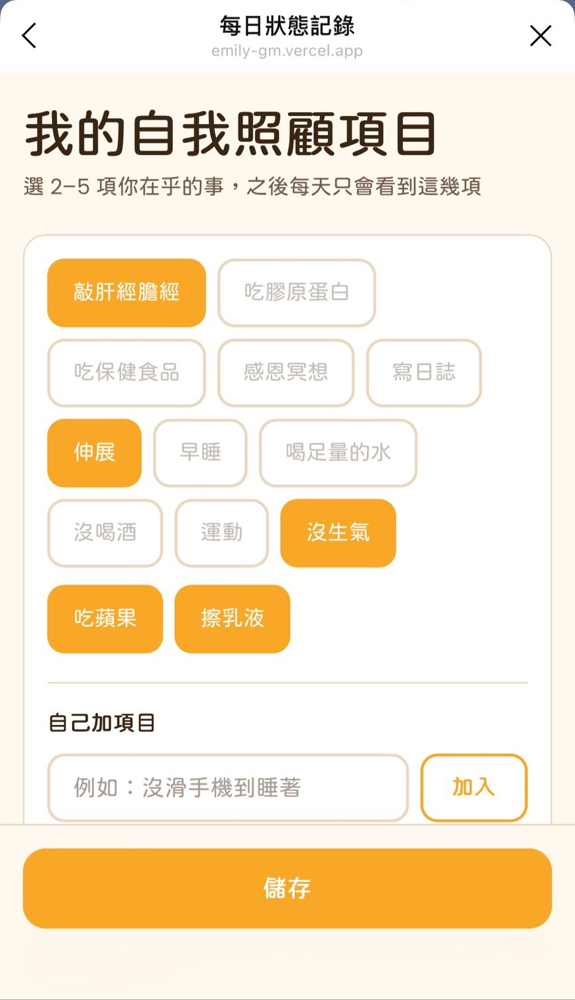
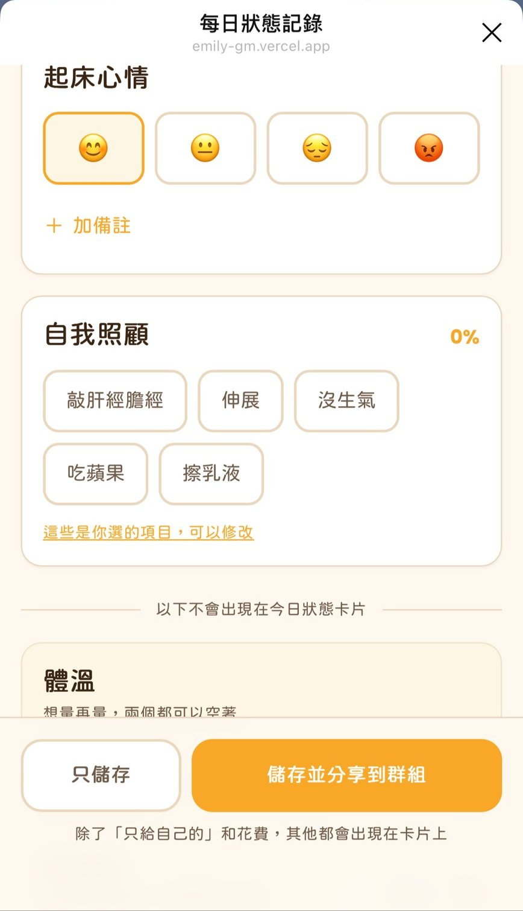
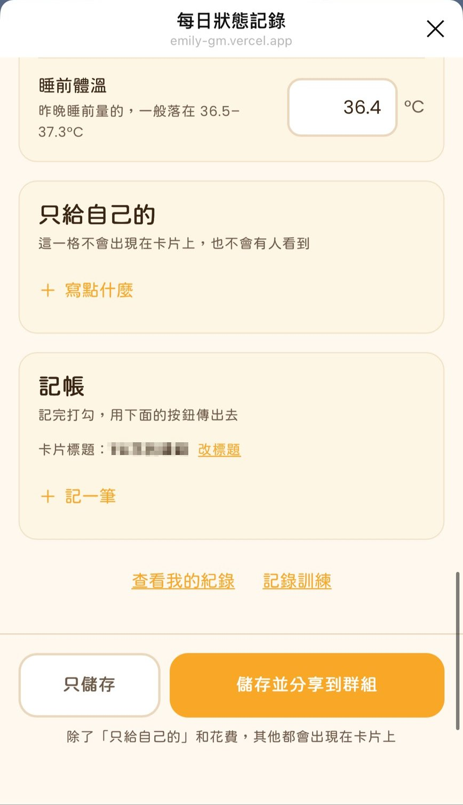
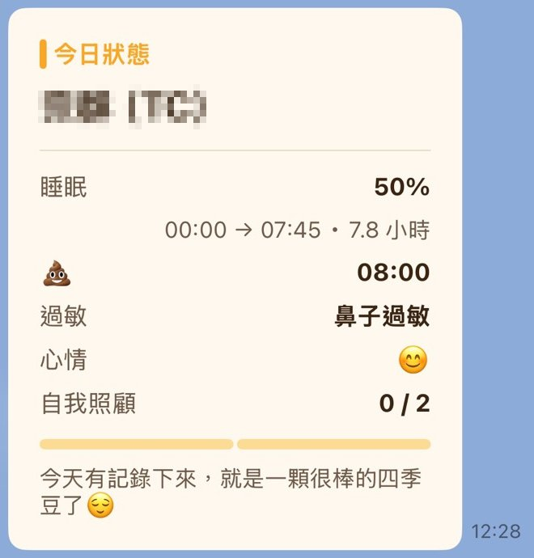
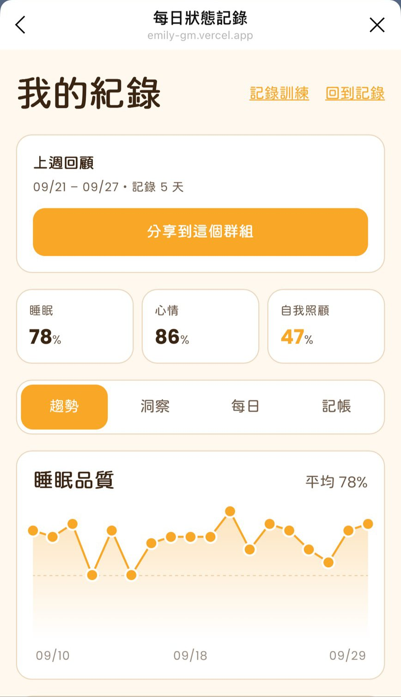
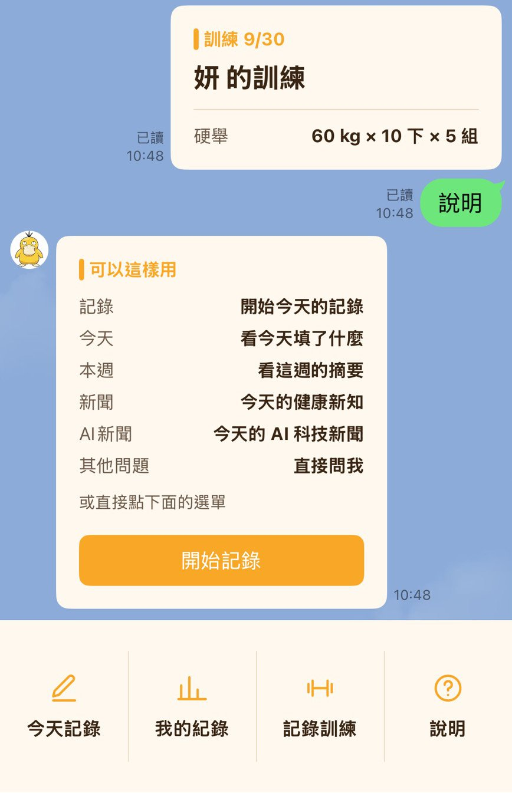

# Emily Good Morning

A LINE mini app (LIFF) for logging how you slept, how you feel, and whether you did the
small things you meant to do — in under ten seconds, without leaving LINE. Fill it in from
a group chat and you can post a summary card back into that chat, so a handful of friends
can keep an eye on each other.

Built end to end: product decisions, data model, backend, frontend, and deployment.

**Stack** — Nuxt 4 (SPA) · TypeScript · Tailwind CSS · Nitro server routes · Supabase
(PostgreSQL) · Vercel · LINE Messaging API · LINE Login / LIFF · Claude API

<table>
  <tr>
    <td align="center"><br><sub>Morning reminder and word of the day</sub></td>
    <td align="center"><br><sub>Daily AI news</sub></td>
    <td align="center"><br><sub>The form</sub></td>
  </tr>
  <tr>
    <td align="center"><br><sub>Each person picks their own habits</sub></td>
    <td align="center"><br><sub>Fields below the line stay off the card</sub></td>
    <td align="center"><br><sub>A note only the user can see</sub></td>
  </tr>
  <tr>
    <td align="center"><br><sub>The summary card friends see</sub></td>
    <td align="center"><br><sub>History and trends</sub></td>
    <td align="center"><br><sub>One-to-one chat and rich menu</sub></td>
  </tr>
</table>

---

## Why it works this way

The hard part of a habit tracker is not storing the data — it is that people stop filling
it in. Most of the design follows from that.

**One record per person per day, filled in whenever.** The form can be submitted half
complete and reopened later; reopening prefills what is already there, so the user is
editing rather than starting over. This is enforced by a `unique (record_date, user_id)`
constraint and an upsert, which also means concurrent submissions are resolved by the
database rather than by application-level locking.

**The reminder is the entry point.** A scheduled push lands in the group each morning and
evening, and the link in it is what opens the form. Morning asks about sleep and mood;
evening asks about the things you cannot answer at 10am, like when you left the office.

**The form asks each person about their own habits.** A fixed list of "self-care" items is
wrong for everybody — some people care about stretching, others about journalling. Each
user picks two to five items from a pool or writes their own, and the completion rate is
measured against their own list.

---

## Design decisions worth explaining

**Identity is verified server-side, never claimed by the client.** The browser sends a LIFF
ID token; the server exchanges it with LINE's verify endpoint and takes the user ID from the
response. The API is a public endpoint, so anything the client asserts about who it is —
including the user ID — is treated as untrusted input. The record date and the completion
score are also computed on the server for the same reason.

**Frontend and backend share one codebase and one set of types.** Nuxt's Nitro server routes
sit next to the pages, so the API is same-origin (no CORS handling at all) and the form
fields, request payloads, and responses are described once in `shared/types/record.ts`.
Changing a field is a single edit that the compiler propagates to both sides.

**Historical numbers do not move.** Each record stores the denominator that applied when it
was written. If someone later changes from three habits to five, past days keep the
completion rate they actually had, instead of being silently recalculated.

**Time is explicit.** The serverless runtime is UTC and the product is date-bounded — one
record per calendar day, a reminder at a wall-clock time. Every date decision converts to
`Asia/Taipei` deliberately rather than relying on the runtime's locale.

**Privacy is tiered, and the tiers are visible in the UI.** A shared card carries a summary;
notes on sleep, mood, digestion and allergies stay in the app; and one field is documented
as never leaving the database. Before a card is shared, the app renders the exact card the
user is about to send rather than describing it in words — a written list of "what gets
shared" goes stale the moment a field is added, a preview cannot.

**Quiet by default in groups.** The bot replies to keywords in a one-to-one chat, but in a
group it answers only when mentioned. Words like "今天" are common enough in ordinary
conversation that a bare keyword trigger would eventually make the bot broadcast someone's
record into a chat nobody asked it to.

**Correlations are shown only when they might mean something.** The insights view compares
days with and against each habit, and hides any comparison where either group has fewer
than three days or the difference is under five points. With small samples almost any
difference is noise, and presenting noise as a finding is worse than showing nothing.

---

## Daily news digest

Each morning a Vercel cron job collects the last 48 hours of articles from RSS feeds and
news APIs in three categories (health, AI, and Taiwan and US stocks) and uses Claude to turn
them into short bilingual stories: three for health, ten each for AI and stocks. Nothing is
pushed: the stories are saved and returned when someone types 新聞, AI新聞 or 股市新聞, and
the 09:00 reminder carries one vocabulary word, rotating through the three categories. The
three categories run in parallel and are written to the database in a single upsert; rows
older than seven days are deleted.

**Two models, two jobs.** Picking stories from dozens of headlines is a simple task over a
large input, so it goes to Claude Haiku. Writing the summaries is the opposite: a small
input with strict rules on length and on which words count as vocabulary, which Haiku did
not follow reliably. That step uses Claude Sonnet, which only sees the chosen articles.

**Naming each event before picking it.** The same story is often covered by several
sources. A rule saying "pick only one" held at three stories but not at ten, where Haiku
chose the same event two or three times. Asking it to write a one-line description of each
event before giving the candidate number lets it spot the repeats itself.

**Summaries are written from the article, not the teaser.** Working only from RSS
descriptions, the model filled the second point with vague commentary and sometimes got
facts wrong. Fetching the chosen articles first makes each point a specific fact.

**The news job runs an hour before the reminder.** Vercel's Hobby plan only guarantees that
a cron job runs somewhere within its scheduled hour. With both jobs in the same hour, the
reminder could run first and go out without a word of the day.

---

## Working within LINE's constraints

Several product decisions are shaped by platform rules that are not obvious until you hit
them:

- `liff.sendMessages()` posts only to the chat the LIFF app was opened from, so sharing a
  card to a group requires opening the app from that group. The morning reminder doubles as
  that entry point.
- A Flex message sent on a user's behalf cannot contain actions. Adding a single button to
  the shared card causes LINE to reject the whole message.
- Reply messages are free while push messages count against a monthly quota, so onboarding
  and all keyword responses use the reply API and only the scheduled reminders use push.
- Group IDs from the Messaging API webhook and from the LIFF context are not the same value,
  which rules out mapping a record back to the group it was filled in from.

---

## Project structure

```
app/           pages, components, and the LIFF composable
server/        Nitro API routes, LINE webhook, scheduled reminders
shared/        types and card builders used by both sides
supabase/      schema and migrations
docs/          setup steps and the original design document
```

## Running it

```bash
pnpm install
pnpm dev          # needs an HTTPS tunnel to be reachable as a LIFF endpoint
pnpm build
pnpm dlx nuxi typecheck
```

Environment variables are listed in [`.env.example`](.env.example). Only `NUXT_PUBLIC_`
values reach the browser; everything else is server-only. Provisioning the LINE channels,
Supabase project, and Vercel deployment is written up in [`docs/SETUP.md`](docs/SETUP.md).
